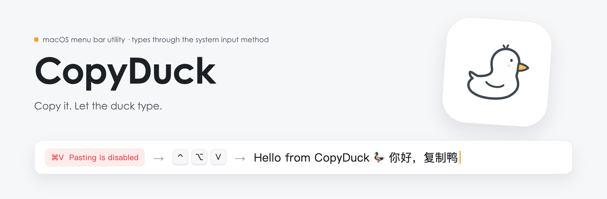
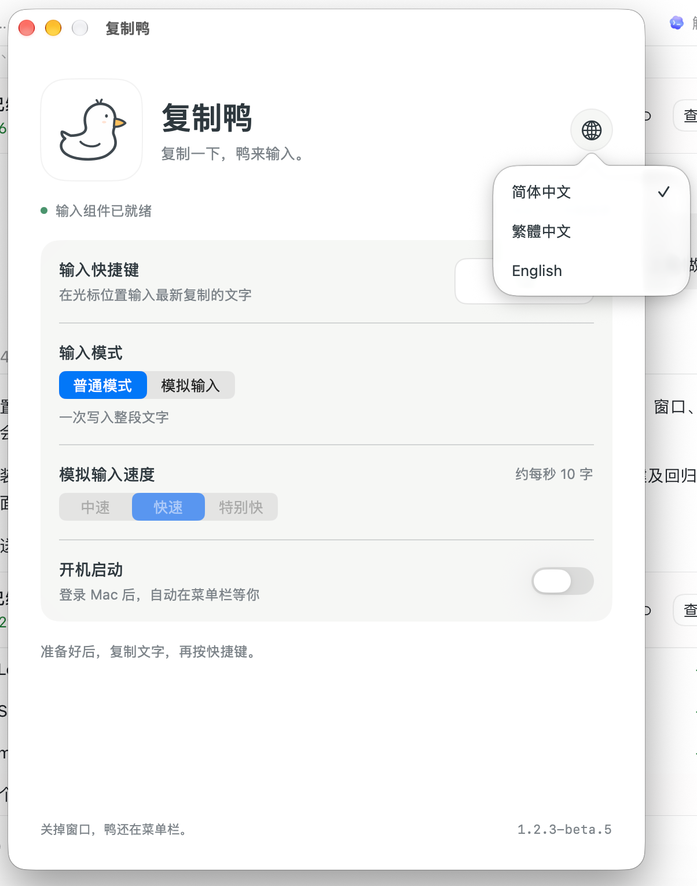
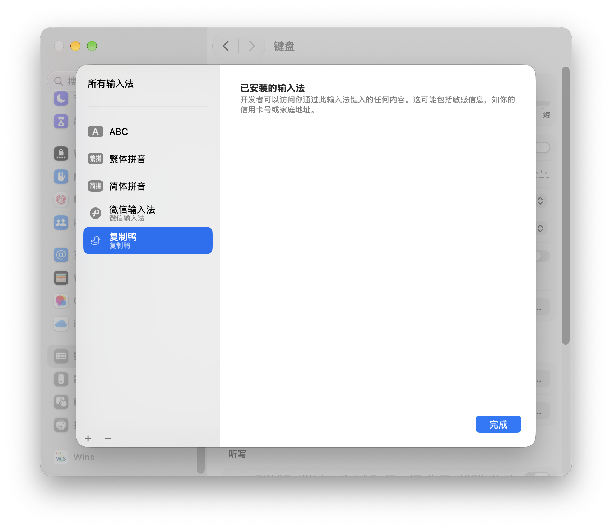
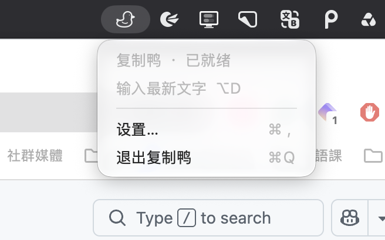

<picture>
  <source media="(prefers-color-scheme: dark)" srcset="assets/readme/banner-en-dark.png">
  
</picture>

<p>
  <a href="https://github.com/yuanruoyu515/CopyDuck/releases/latest"></a>
  
  
  
  <a href="https://www.threads.com/@realtimyry"></a>
</p>

[简体中文](README.md) · [繁體中文](README.zh-Hant.md) · **English** · [Three-language introduction](https://yuanruoyu515.github.io/CopyDuck/en/index.html) · [All releases](https://github.com/yuanruoyu515/CopyDuck/releases)

💢 An input field blocks pasting or distinguishes pasted text from regular input, leaving you to type everything again?

🐤 CopyDuck is a lightweight macOS menu bar utility. Press a shortcut to insert plain text from your clipboard into the active input field through the system input method. It helps with some websites and apps that disable pasting or intercept paste shortcuts while still supporting system input methods, saving you from retyping long passages. It supports Chinese, English, line breaks and emoji. All text processing happens locally on your Mac, with no uploads or clipboard history.

**💦 The inspiration**　The author was struggling to finish assignments in AP CSA when Albert was configured to block pasting. The workaround was to keep changing the input method’s text shortcuts to get the text into the field, bit by bit… That frustration led to CopyDuck.

##  Features

- **Your shortcut**: Start with ⌃⌥V, or choose your own in Settings.
- **A home in the menu bar**: No Dock icon. Closing Settings keeps the duck running.
- **Optional launch at login**: Enable it when you want CopyDuck ready after login.
- **Text stays on your Mac**: Reads the clipboard only when triggered. No history, no network connection.
- **Simulated typing**: Switch between Normal and Simulated Typing in Settings or the menu bar. Medium, Fast and Very Fast average about 5, 10 and 20 characters per second, with pauses at punctuation and line breaks. Mode and speed are remembered; speed changes apply to the next request. Press the shortcut again, type manually or change input focus to stop. Text already entered is kept.
- **Input reliability and resource cleanup**: Improve first-trigger behavior in Word and prevent unintended typing cancellation. Release the Settings view on close; clear text references, callbacks and scheduled tasks when input finishes or is cancelled.
- **Three interface languages**: Use the globe in the top right of Settings to switch languages. Your choice is saved.

### Three steps

1. **Copy**　Copy some plain text.
2. **Focus**　Click where you want to type.
3. **Insert**　Press your shortcut. Let the duck type.

<table>
  <tr>
    <td width="34%" valign="top">
      
      <p><b>Settings window</b><br><sub>Click the globe in the top right to choose Simplified Chinese, Traditional Chinese or English. Settings also includes input mode, speed, shortcut and launch-at-login controls.</sub></p>
    </td>
    <td width="40%" valign="top">
      
      <p><b>System input sources</b><br><sub>CopyDuck appears in the list of installed system input sources.</sub></p>
    </td>
    <td width="26%" valign="top">
      
      <p><b>Menu bar menu</b><br><sub>Open the duck menu to switch Normal / Simulated Typing and choose one of three speeds in the submenu.</sub></p>
    </td>
  </tr>
</table>

<sub>The maintainer supplied the Settings screenshot while testing 1.2.3-beta.5; it shows the language switcher in the top right. The other screenshots are from 1.2-beta.1. ⌥D is a custom shortcut; the default is ⌃⌥V.</sub>

##  Downloads

Apple Silicon · Minimum build target: macOS 14 · Verified only on macOS 27.0.1

**[Download the latest version · 1.2.3 DMG](https://github.com/yuanruoyu515/CopyDuck/releases/download/v1.2.3/CopyDuck-1.2.3-arm64.dmg)** · [App ZIP](https://github.com/yuanruoyu515/CopyDuck/releases/download/v1.2.3/CopyDuck-1.2.3-arm64.app.zip) · [Release notes](https://github.com/yuanruoyu515/CopyDuck/releases/tag/v1.2.3)

1. Download the DMG and drag “复制鸭” into Applications.
2. Open CopyDuck and click "Install input component" on first use.
3. Once "Input component ready" appears, copy text, focus a field and press your shortcut.

Opening a newer build automatically updates and starts the input component, preserving your shortcut and launch-at-login setting.

Default shortcut: <kbd>⌃</kbd> <kbd>⌥</kbd> <kbd>V</kbd> (Control + Option + V).

<details>
<summary>Older versions</summary>

| Version | Download | Notes |
| --- | --- | --- |
| 1.2.2 | [DMG](https://github.com/yuanruoyu515/CopyDuck/releases/download/v1.2.2/CopyDuck-1.2.2-arm64.dmg) · [App ZIP](https://github.com/yuanruoyu515/CopyDuck/releases/download/v1.2.2/CopyDuck-1.2.2-arm64.app.zip) | [Release notes](https://github.com/yuanruoyu515/CopyDuck/releases/tag/v1.2.2) |
| 1.2.1 | [DMG](https://github.com/yuanruoyu515/CopyDuck/releases/download/v1.2.1/CopyDuck-1.2.1-arm64.dmg) · [App ZIP](https://github.com/yuanruoyu515/CopyDuck/releases/download/v1.2.1/CopyDuck-1.2.1-arm64.app.zip) | [Release notes](https://github.com/yuanruoyu515/CopyDuck/releases/tag/v1.2.1) |
| 1.2 | [DMG](https://github.com/yuanruoyu515/CopyDuck/releases/download/v1.2/CopyDuck-1.2-arm64.dmg) · [App ZIP](https://github.com/yuanruoyu515/CopyDuck/releases/download/v1.2/CopyDuck-1.2-arm64.app.zip) | [Release notes](https://github.com/yuanruoyu515/CopyDuck/releases/tag/v1.2) |
| 1.1 | [DMG](https://github.com/yuanruoyu515/CopyDuck/releases/download/v1.1/CopyDuck-1.1-arm64.dmg) · [App ZIP](https://github.com/yuanruoyu515/CopyDuck/releases/download/v1.1/CopyDuck-1.1-arm64.app.zip) | [Release notes](https://github.com/yuanruoyu515/CopyDuck/releases/tag/v1.1) |
| 1.0 | [DMG](https://github.com/yuanruoyu515/CopyDuck/releases/download/v1.0/CopyDuck-1.0-arm64.dmg) · [App ZIP](https://github.com/yuanruoyu515/CopyDuck/releases/download/v1.0/CopyDuck-1.0-arm64.app.zip) | [Release notes](https://github.com/yuanruoyu515/CopyDuck/releases/tag/v1.0) |

</details>

##  Requirements

| | |
| --- | --- |
| Chip | Apple Silicon only |
| macOS | Minimum build target macOS 14. Verified only on macOS 27.0.1 |
| Input field | Must support system input methods. Some secure fields or custom controls may restrict input |
| Signing | Locally signed, without Developer ID signing or Apple notarization |
| Dependencies | System frameworks only. No third-party runtime dependencies |

##  How it works

CopyDuck appears under Simplified Chinese input sources. When you press the shortcut, it reads the latest clipboard text, temporarily selects its input source, inserts the whole text at once or types it character by character, then restores your previous input method. Copying something else while typing does not change the current request.

```text
NSPasteboard → TISSelectInputSource → IMKTextInput.insertText → restore previous input source
```

##  Scope and FAQ

**What can it insert?**
Plain text, including Chinese, English, line breaks and emoji. Images, files and rich text are not supported. The target field must support system input methods; some secure fields or custom controls may restrict input.

**What if the input component is missing?**
Add “复制鸭” under System Settings → Keyboard → Text Input → Edit → ＋ → Simplified Chinese, then reopen the app. Some first-time installations require logging out and back in.

**Why does macOS show a security prompt?**
The downloads are locally signed, without Developer ID signing or Apple notarization. Another Mac may require confirmation in Privacy & Security before opening the app.

##  Quit and uninstall

Choose “退出复制鸭” (Quit CopyDuck) in its menu. Before uninstalling, disable launch at login, remove its keyboard input source, then remove the app from Applications and ~/Library/Input Methods/复制鸭.app.

## Version history

- **1.2.3**: Fixes intermittent input failures after automatic input-method switching in Safari, filters repeated shortcut presses while the key is held, and adds Simplified Chinese, Traditional Chinese and English interfaces.
- **1.2.2**: Fixes startup process failures and repeated launches that cause excessive resource usage, and fixes Settings failing to open.
- **1.2.1**: Improves first-trigger behavior in Word, prevents unintended input cancellation, and strengthens resource cleanup when cancelling input or closing Settings.
- **1.2**: Adds Normal / Simulated Typing and three speeds.
- **1.1**: Fixes component startup and centers the icons.
- **1.0**: The original feature release.

Git history preserves stable and beta version tags. Maintain future changes on main. See the release workflow in [the development guide](DEVELOPMENT.md).

## Build from source

Install Apple Command Line Tools and Python 3, then run from the project directory:

```sh
zsh build.sh
```

Produces build/复制鸭.app. Release builds exclude the test trigger. The app uses system frameworks and has no third-party runtime dependencies.

Test simulated typing, speed and cancellation, and check icon alignment at standard and Retina resolutions:

```sh
zsh scripts/test_typing.sh
zsh scripts/test_icons.sh
```

Generate an App ZIP and a drag-to-install DMG (packaging dependencies require Python 3.10 or newer):

```sh
zsh scripts/package.sh
```

## Credits

Section icons: [Phosphor Icons](https://phosphoricons.com) (MIT).

Made by Ruoyu. Find me on Threads: [@realtimyry](https://www.threads.com/@realtimyry).
