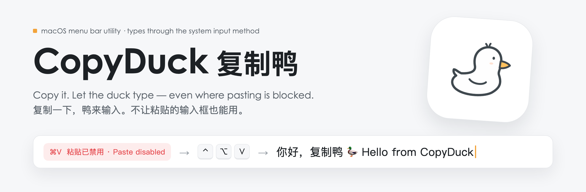
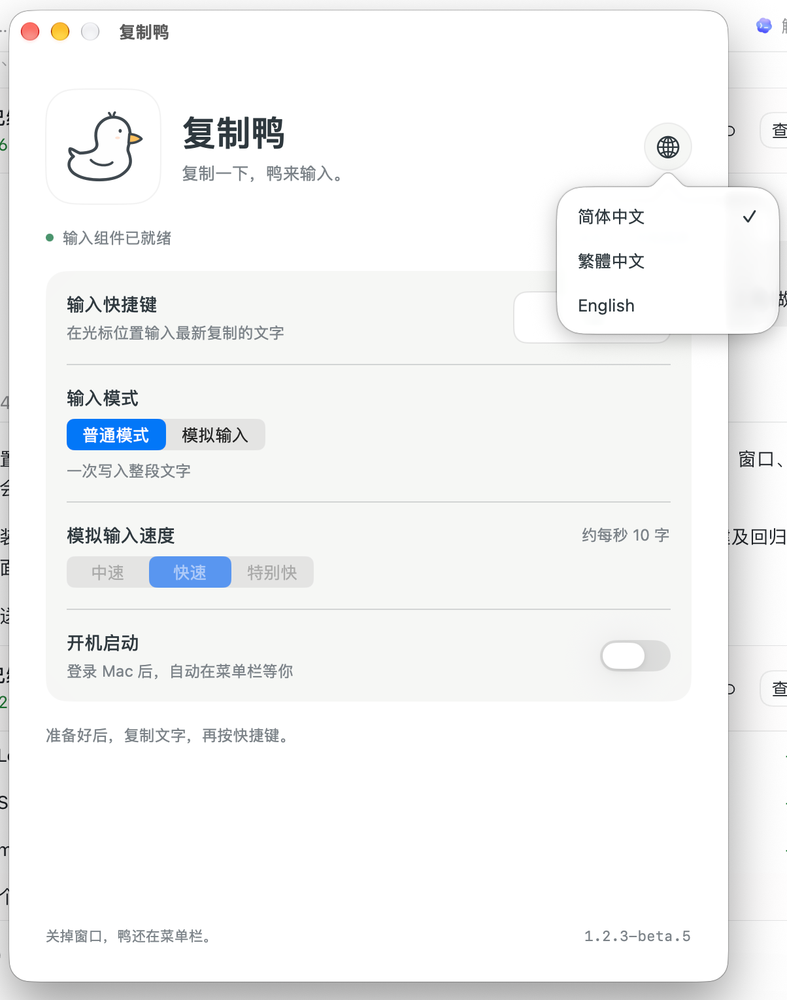
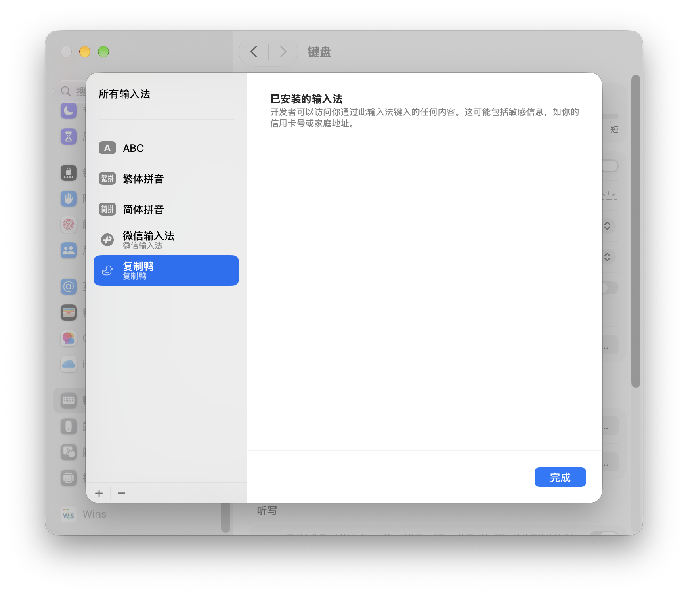

<picture>
  <source media="(prefers-color-scheme: dark)" srcset="assets/readme/banner-zh-Hans-dark.png">
  
</picture>

<p>
  <a href="https://github.com/yuanruoyu515/CopyDuck/releases/latest"></a>
  
  
  
  <a href="https://www.threads.com/@realtimyry"></a>
</p>

**简体中文** · [繁體中文](README.zh-Hant.md) · [English](README.en.md) · [三语介绍页](https://yuanruoyu515.github.io/CopyDuck/index.html) · [所有版本](https://github.com/yuanruoyu515/CopyDuck/releases)

💢 输入框不让粘贴，或者会区分粘贴与正常输入，让你只能重新手打一遍？

🐤 复制鸭（CopyDuck）是一款轻量的 macOS 菜单栏工具：按下快捷键，就能通过系统输入法，将剪贴板中的纯文字直接输入当前输入框。它适用于部分禁用粘贴、拦截粘贴快捷键，但仍支持系统输入法的网页和应用，减少重复录入长段文字的麻烦。支持中文、英文、换行和表情，文字处理全程在本机完成，不上传内容，也不保存剪贴板历史。

**💦 灵感来源**　作者在上 AP CSA 课时赶不完作业，偏偏 Albert 又被设置成不能粘贴，只好反复修改输入法的快捷输入词，把文字一点点塞进去……于是，就有了复制鸭。

> [!WARNING]
> **兼容性与资源占用提醒**
> 目前仅在 macOS 27.0.1 上验证，不保证 macOS 27 以下版本可用。已有用户反馈：修复前版本在 macOS 26 上出现内存与 CPU 占用异常飙升；新版在该系统上的表现仍待验证。如遇异常，请立即退出复制鸭；无法退出时，可在活动监视器中结束 CopyDuck 进程。

##  功能

- **你的快捷键**：默认 ⌃⌥V，也可以在设置中换成顺手的组合。
- **待在菜单栏**：不占 Dock；关掉设置窗口，仍在后台等你。
- **开机启动可选**：需要时开启，登录 Mac 后自动运行。
- **文字留在本机**：按快捷键时才读取剪贴板，不保存历史，不连接网络。
- **模拟输入**：在设置或菜单栏切换普通模式／模拟输入。中速、快速、特别快约为每秒 5、10、20 字，标点和换行稍作停顿。模式和速度会记住；速度调整从下次输入生效。再次按快捷键、手动打字或切换输入位置可停止，已输入的文字会保留。
- **输入稳定与资源清理**：改善 Word 首次触发和模拟输入误停。关闭设置时释放界面；输入结束或取消后清理文字引用、回调和定时任务。
- **三语界面**：点击设置窗口右上角的地球图标切换语言，选择会自动保存。

### 三步用起来

1. **复制**　复制一段纯文字。
2. **定位**　点击要输入文字的位置。
3. **输入**　按下快捷键，鸭来写进去。

<table>
  <tr>
    <td width="34%" valign="top">
      
      <p><b>设置窗口</b><br><sub>点击右上角地球图标，可切换简体中文、繁體中文或 English；也可调整输入模式、速度、快捷键和开机启动。</sub></p>
    </td>
    <td width="40%" valign="top">
      
      <p><b>系统输入法列表</b><br><sub>复制鸭作为系统输入法出现在已安装列表中。</sub></p>
    </td>
    <td width="26%" valign="top">
      
      <p><b>菜单栏菜单</b><br><sub>点开菜单栏小鸭子，即可切换普通模式／模拟输入，并在子菜单选择三档速度。</sub></p>
    </td>
  </tr>
</table>

<sub>设置窗口截图由维护者试用 1.2.3-beta.5 时提供，展示右上角的语言切换；其余截图来自 1.2-beta.1。⌥D 是自定义快捷键，默认是 ⌃⌥V。</sub>

##  下载

Apple Silicon · 构建最低版本 macOS 14 · 仅在 macOS 27.0.1 上验证

**[下载最新版 · 1.2.3 DMG](https://github.com/yuanruoyu515/CopyDuck/releases/download/v1.2.3/CopyDuck-1.2.3-arm64.dmg)** · [App 压缩包](https://github.com/yuanruoyu515/CopyDuck/releases/download/v1.2.3/CopyDuck-1.2.3-arm64.app.zip) · [发布说明](https://github.com/yuanruoyu515/CopyDuck/releases/tag/v1.2.3)

1. 下载 DMG，把“复制鸭”拖进“应用程序”。
2. 打开复制鸭，首次点击“安装输入组件”。
3. 看到“输入组件已就绪”后，复制文字，再到输入框按快捷键。

打开新版会自动更新并启动输入组件，保留原快捷键和开机启动设置。

默认快捷键: <kbd>⌃</kbd> <kbd>⌥</kbd> <kbd>V</kbd> (Control + Option + V).

<details>
<summary>历史版本</summary>

| 版本 | 下载 | 说明 |
| --- | --- | --- |
| 1.2.2 | [DMG](https://github.com/yuanruoyu515/CopyDuck/releases/download/v1.2.2/CopyDuck-1.2.2-arm64.dmg) · [App 压缩包](https://github.com/yuanruoyu515/CopyDuck/releases/download/v1.2.2/CopyDuck-1.2.2-arm64.app.zip) | [发布说明](https://github.com/yuanruoyu515/CopyDuck/releases/tag/v1.2.2) |
| 1.2.1 | [DMG](https://github.com/yuanruoyu515/CopyDuck/releases/download/v1.2.1/CopyDuck-1.2.1-arm64.dmg) · [App 压缩包](https://github.com/yuanruoyu515/CopyDuck/releases/download/v1.2.1/CopyDuck-1.2.1-arm64.app.zip) | [发布说明](https://github.com/yuanruoyu515/CopyDuck/releases/tag/v1.2.1) |
| 1.2 | [DMG](https://github.com/yuanruoyu515/CopyDuck/releases/download/v1.2/CopyDuck-1.2-arm64.dmg) · [App 压缩包](https://github.com/yuanruoyu515/CopyDuck/releases/download/v1.2/CopyDuck-1.2-arm64.app.zip) | [发布说明](https://github.com/yuanruoyu515/CopyDuck/releases/tag/v1.2) |
| 1.1 | [DMG](https://github.com/yuanruoyu515/CopyDuck/releases/download/v1.1/CopyDuck-1.1-arm64.dmg) · [App 压缩包](https://github.com/yuanruoyu515/CopyDuck/releases/download/v1.1/CopyDuck-1.1-arm64.app.zip) | [发布说明](https://github.com/yuanruoyu515/CopyDuck/releases/tag/v1.1) |
| 1.0 | [DMG](https://github.com/yuanruoyu515/CopyDuck/releases/download/v1.0/CopyDuck-1.0-arm64.dmg) · [App 压缩包](https://github.com/yuanruoyu515/CopyDuck/releases/download/v1.0/CopyDuck-1.0-arm64.app.zip) | [发布说明](https://github.com/yuanruoyu515/CopyDuck/releases/tag/v1.0) |

</details>

##  运行要求

| | |
| --- | --- |
| 芯片 | Apple Silicon（暂无 Intel 版本） |
| 系统 | 构建最低版本 macOS 14，目前仅在 macOS 27.0.1 上验证 |
| 输入框 | 需要支持系统输入法；部分安全输入框或自定义控件可能限制输入 |
| 签名 | 本机签名，尚未使用 Developer ID 签名或 Apple 公证 |
| 依赖 | 只用系统框架，无第三方运行依赖 |

##  工作原理

复制鸭可以添加到“简体中文”输入法列表。触发快捷键时，它读取最新剪贴板、临时切换输入源，按所选模式一次写入整段或逐字输入，再恢复你原来的输入法。输入途中复制其他文字不会改变本次内容。

```text
NSPasteboard → TISSelectInputSource → IMKTextInput.insertText → restore previous input source
```

##  使用范围与常见问题

**支持哪些内容？**
支持纯文字，包括中文、英文、换行和表情；不支持图片、文件或富文本格式。目标输入框需要支持系统输入法，部分安全输入框或自定义控件可能限制输入。

**找不到输入组件怎么办？**
在系统设置 → 键盘 → 文本输入 → 编辑 → ＋ → 简体中文中添加“复制鸭”，再重新打开应用。个别首次安装需要注销并重新登录。

**下载后出现系统安全提示？**
目前提供本机签名版本，尚未使用 Developer ID 签名或 Apple 公证。在其他 Mac 上打开时，系统可能要求在“隐私与安全性”中确认。

##  退出与卸载

从菜单栏选择“退出复制鸭”。卸载前关闭开机启动，在系统键盘设置移除输入法，再移走应用程序和 ~/Library/Input Methods/复制鸭.app。

## 版本记录

- **1.2.3**：修复 Safari 自动切换输入法后偶尔无法输入的问题，过滤按住快捷键时的重复触发，并新增简体中文、繁體中文和 English 界面。
- **1.2.2**：修复进程无法正确运行、重复启动造成大量资源占用的问题，并修复设置窗口无法正常打开。
- **1.2.1**：改善 Word 首次触发和输入误停，强化取消任务与关闭设置时的内存清理。
- **1.2**：增加普通模式／模拟输入切换和三档打字速度。
- **1.1**：修复组件自动启动并调整图标。
- **1.0**：保留最初的功能版本。

Git 历史保留各正式版本与 beta 标签；后续修改在 main 分支维护。发布流程见 [开发说明](DEVELOPMENT.md).

## 从源码构建

安装 Apple Command Line Tools 和 Python 3 后，在项目目录运行：

```sh
zsh build.sh
```

生成 build/复制鸭.app。正式构建不会包含测试触发入口。项目使用系统框架，无第三方运行依赖。

验证模拟输入的文字、速度与停止逻辑，并检查普通和 Retina 尺寸下的图标居中：

```sh
zsh scripts/test_typing.sh
zsh scripts/test_icons.sh
```

生成 App 压缩包和带拖拽布局的 DMG（打包依赖要求 Python 3.10 及以上）：

```sh
zsh scripts/package.sh
```

## 致谢

章节图标来自 [Phosphor Icons](https://phosphoricons.com)（MIT）。

Ruoyu 做的。Threads 上找我：[@realtimyry](https://www.threads.com/@realtimyry)。
