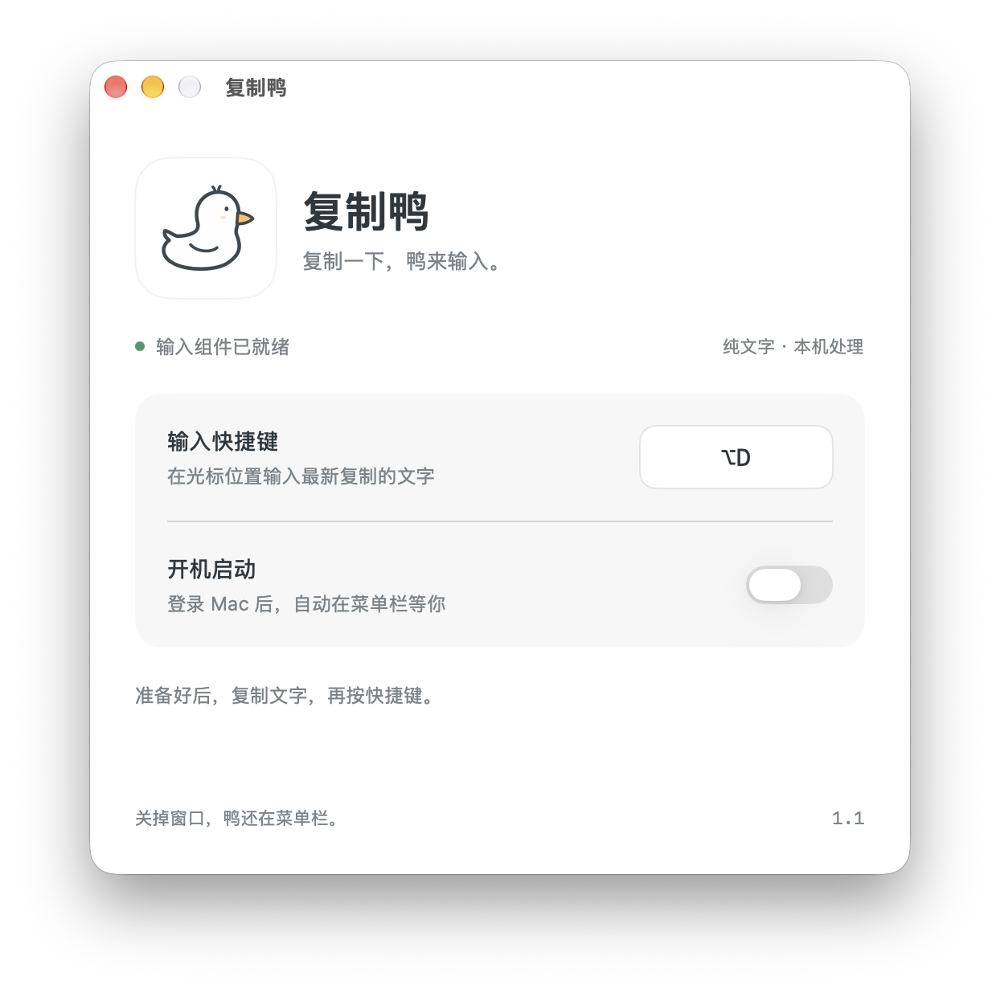
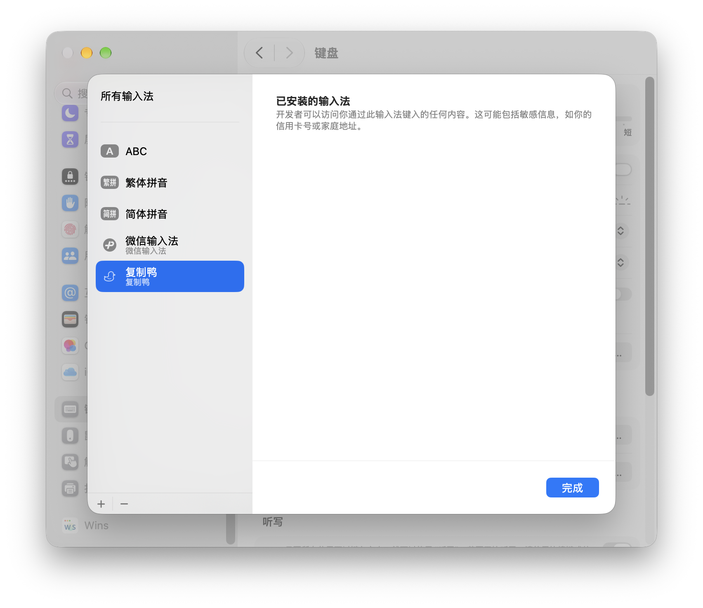

<p align="center"></p>

# 複製鴨 · CopyDuck

[简体中文](README.md) · [繁體中文](README.zh-Hant.md) · [English](README.en.md)

> [!WARNING]
> **相容性與資源占用提醒**
> 目前僅在 macOS 27.0.1 上驗證，不保證 macOS 27 以下版本可用。已有使用者回報：修復前版本在 macOS 26 上出現記憶體與 CPU 使用量異常飆升；新版在該系統上的表現仍待驗證。如遇異常，請立即結束複製鴨；無法結束時，可在「活動監視器」中結束 CopyDuck 程序。

**複製一下，鴨來輸入。**

💢 輸入框不讓貼上，或是會區分貼上與一般輸入，讓你只能重新手打一遍？

🐤 複製鴨（CopyDuck）是一款輕量的 macOS 選單列工具：按下快捷鍵，就能透過系統輸入法，將剪貼簿中的純文字直接輸入目前的輸入框。它適用於部分停用貼上、攔截貼上快捷鍵，但仍支援系統輸入法的網頁和應用程式，減少重複輸入長段文字的麻煩。支援中文、英文、換行和表情，文字處理全程在本機完成，不上傳內容，也不儲存剪貼簿歷史。

## 💦 靈感來源

作者上 AP CSA 課時趕不完作業，偏偏 Albert 又被設定成不能貼上，只好反覆修改輸入法的快捷輸入詞，把文字一點一點塞進去……於是，就有了複製鴨。

[三語介紹頁](https://yuanruoyu515.github.io/CopyDuck/zh-Hant/index.html) · [所有版本](https://github.com/yuanruoyu515/CopyDuck/releases)

## 下載

Apple Silicon · 建置最低版本 macOS 14 · 僅在 macOS 27.0.1 上驗證

| 版本 | 下載 | 說明 |
| --- | --- | --- |
| 1.2.1 | [DMG](https://github.com/yuanruoyu515/CopyDuck/releases/download/v1.2.1/CopyDuck-1.2.1-arm64.dmg) · [App 壓縮檔](https://github.com/yuanruoyu515/CopyDuck/releases/download/v1.2.1/CopyDuck-1.2.1-arm64.app.zip) | [版本說明](https://github.com/yuanruoyu515/CopyDuck/releases/tag/v1.2.1) |
| 1.2 | [DMG](https://github.com/yuanruoyu515/CopyDuck/releases/download/v1.2/CopyDuck-1.2-arm64.dmg) · [App 壓縮檔](https://github.com/yuanruoyu515/CopyDuck/releases/download/v1.2/CopyDuck-1.2-arm64.app.zip) | [版本說明](https://github.com/yuanruoyu515/CopyDuck/releases/tag/v1.2) |
| 1.1 | [DMG](https://github.com/yuanruoyu515/CopyDuck/releases/download/v1.1/CopyDuck-1.1-arm64.dmg) · [App 壓縮檔](https://github.com/yuanruoyu515/CopyDuck/releases/download/v1.1/CopyDuck-1.1-arm64.app.zip) | [版本說明](https://github.com/yuanruoyu515/CopyDuck/releases/tag/v1.1) |
| 1.0 | [DMG](https://github.com/yuanruoyu515/CopyDuck/releases/download/v1.0/CopyDuck-1.0-arm64.dmg) · [App 壓縮檔](https://github.com/yuanruoyu515/CopyDuck/releases/download/v1.0/CopyDuck-1.0-arm64.app.zip) | [版本說明](https://github.com/yuanruoyu515/CopyDuck/releases/tag/v1.0) |

## 功能

- **你的快捷鍵**：預設 ⌃⌥V，也可以在設定中換成順手的組合。
- **待在選單列**：不占 Dock；關閉設定視窗，仍在背景等你。
- **登入時啟動可選**：需要時開啟，登入 Mac 後自動執行。
- **文字留在本機**：按快捷鍵時才讀取剪貼簿，不儲存歷史，不連接網路。
- **模擬輸入**：在設定或選單列切換一般模式／模擬輸入。中速、快速、特別快約為每秒 5、10、20 字，標點與換行稍作停頓。會記住模式和速度；速度調整從下次輸入生效。再次按快捷鍵、手動打字或切換輸入位置即可停止，已輸入的文字會保留。
- **輸入穩定與資源清理**：改善 Word 首次觸發與模擬輸入誤停。關閉設定時釋放介面；輸入結束或取消後清理文字參照、回呼與計時任務。

## 真實介面，輕巧直觀。

設定視窗與選單列截圖由維護者試用 1.2-beta.1 時提供，展示 1.2 新增功能。介面為簡體中文；⌥D 是自訂快捷鍵，預設為 ⌃⌥V。

### 設定視窗



在設定中切換輸入模式，選擇中速、快速或特別快，並調整快捷鍵與登入時啟動。

### 系統輸入法列表



複製鴨以系統輸入法顯示於已安裝列表中。

### 選單列選單


點開選單列小鴨子，即可切換一般模式／模擬輸入，並在子選單選擇三段速度。

## 安裝與使用

1. 下載 DMG，把「复制鸭」拖進「應用程式」。
2. 開啟複製鴨，首次點選「安装输入组件」。
3. 看到「输入组件已就绪」後，複製文字，再到輸入框按快捷鍵。

開啟新版會自動更新並啟動輸入元件，保留原快捷鍵與登入時啟動設定。

預設快捷鍵: **⌃⌥V** (Control + Option + V).

## 運作原理

複製鴨可以加入「簡體中文」輸入法列表。觸發快捷鍵時，它讀取最新剪貼簿、暫時切換輸入來源，依選取的模式一次寫入整段或逐字輸入，再恢復原本的輸入法。輸入途中複製其他文字不會改變本次內容。

`NSPasteboard → TISSelectInputSource → IMKTextInput.insertText → restore previous input source`

## 使用範圍與簽署

支援純文字，包括中文、英文、換行和表情；不支援圖片、檔案或富文字格式。目標輸入框須支援系統輸入法，部分安全輸入框或自訂控制項可能限制輸入。

在系統設定 → 鍵盤 → 文字輸入 → 編輯 → ＋ → 簡體中文中加入「复制鸭」，再重新開啟應用程式。個別首次安裝需要登出並重新登入。

目前提供本機簽署版本，尚未使用 Developer ID 簽署或 Apple 公證。在其他 Mac 上開啟時，系統可能要求在「隱私權與安全性」中確認。

從選單列選擇「退出复制鸭」。移除前關閉登入時啟動，在系統鍵盤設定移除輸入法，再移走應用程式與 ~/Library/Input Methods/复制鸭.app。

## 版本紀錄

1.2.1 改善 Word 首次觸發與輸入誤停，強化取消任務與關閉設定時的記憶體清理。1.2 新增一般模式／模擬輸入切換與三段打字速度；1.1 修復元件自動啟動並調整圖示；1.0 保留最初的功能版本。

Git 歷史保留 v1.0、v1.1、v1.2 與 v1.2.1 標籤；後續修改在 main 分支維護。發佈流程請見 [開發說明](DEVELOPMENT.md).

## 從原始碼建置

安裝 Apple Command Line Tools 與 Python 3 後，在專案目錄執行：

```sh
zsh build.sh
```

產生 build/复制鸭.app。正式建置不包含測試觸發入口。專案使用系統框架，沒有第三方執行相依套件。

驗證模擬輸入的文字、速度與停止邏輯，並檢查一般與 Retina 尺寸下的圖示置中：

```sh
zsh scripts/test_typing.sh
zsh scripts/test_icons.sh
```

產生 App 壓縮檔與可拖曳安裝的 DMG：

```sh
zsh scripts/package.sh
```
