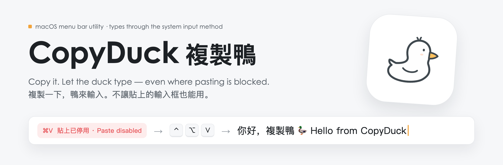
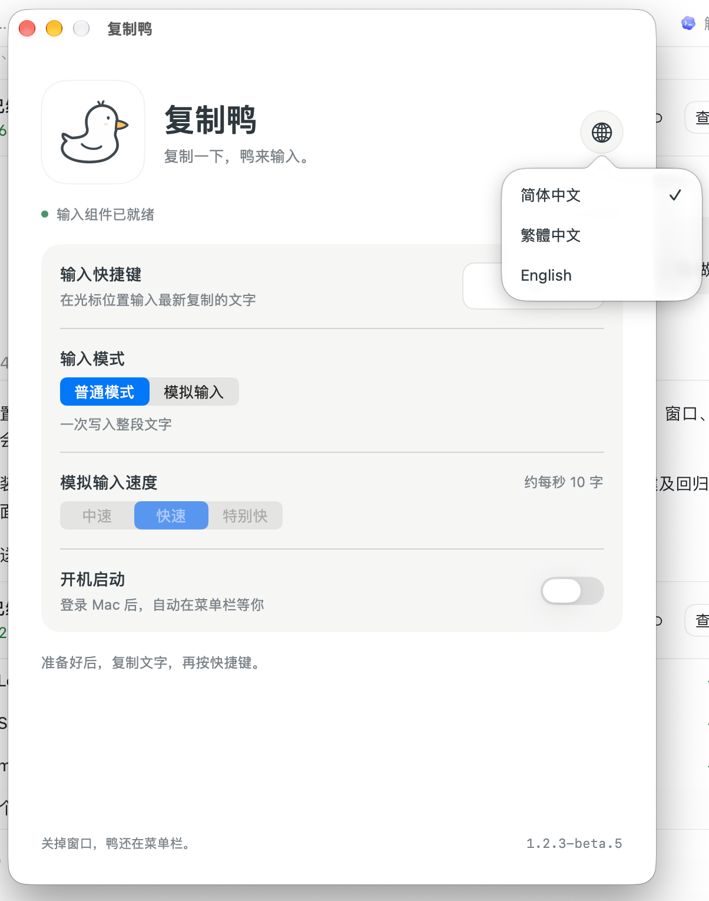
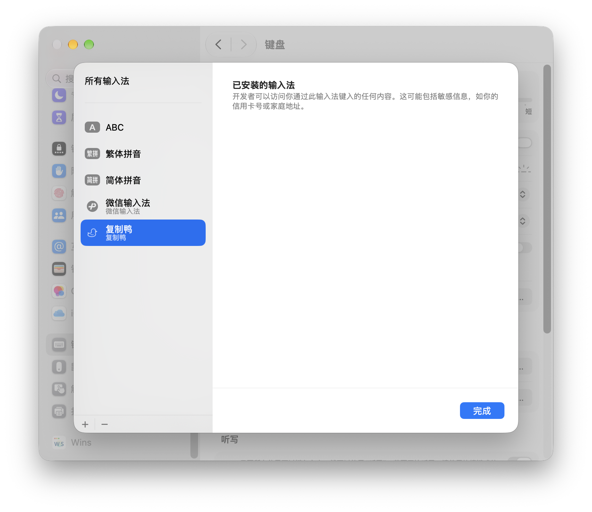
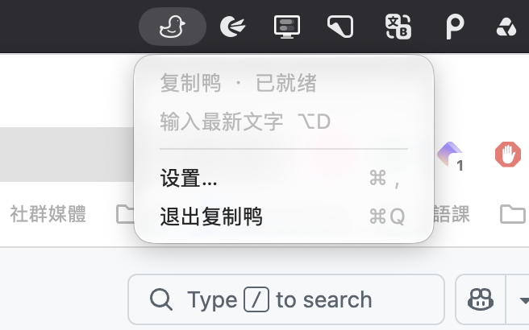

<picture>
  <source media="(prefers-color-scheme: dark)" srcset="assets/readme/banner-zh-Hant-dark.png">
  
</picture>

<p>
  <a href="https://github.com/yuanruoyu515/CopyDuck/releases/latest"></a>
  
  
  
  <a href="https://www.threads.com/@realtimyry"></a>
</p>

[简体中文](README.md) · **繁體中文** · [English](README.en.md) · [三語介紹頁](https://yuanruoyu515.github.io/CopyDuck/zh-Hant/index.html) · [所有版本](https://github.com/yuanruoyu515/CopyDuck/releases)

💢 輸入框不讓貼上，或是會區分貼上與一般輸入，讓你只能重新手打一遍？

🐤 複製鴨（CopyDuck）是一款輕量的 macOS 選單列工具：按下快捷鍵，就能透過系統輸入法，將剪貼簿中的純文字直接輸入目前的輸入框。它適用於部分停用貼上、攔截貼上快捷鍵，但仍支援系統輸入法的網頁和應用程式，減少重複輸入長段文字的麻煩。支援中文、英文、換行和表情，文字處理全程在本機完成，不上傳內容，也不儲存剪貼簿歷史。

**💦 靈感來源**　作者上 AP CSA 課時趕不完作業，偏偏 Albert 又被設定成不能貼上，只好反覆修改輸入法的快捷輸入詞，把文字一點一點塞進去……於是，就有了複製鴨。

##  功能

- **你的快捷鍵**：預設 ⌃⌥V，也可以在設定中換成順手的組合。
- **待在選單列**：不占 Dock；關閉設定視窗，仍在背景等你。
- **登入時啟動可選**：需要時開啟，登入 Mac 後自動執行。
- **文字留在本機**：按快捷鍵時才讀取剪貼簿，不儲存歷史，不連接網路。
- **模擬輸入**：在設定或選單列切換一般模式／模擬輸入。中速、快速、特別快約為每秒 5、10、20 字，標點與換行稍作停頓。會記住模式和速度；速度調整從下次輸入生效。再次按快捷鍵、手動打字或切換輸入位置即可停止，已輸入的文字會保留。
- **輸入穩定與資源清理**：改善 Word 首次觸發與模擬輸入誤停。關閉設定時釋放介面；輸入結束或取消後清理文字參照、回呼與計時任務。
- **三語介面**：點選設定視窗右上角的地球圖示切換語言，選擇會自動儲存。

### 三步用起來

1. **複製**　複製一段純文字。
2. **定位**　點選要輸入文字的位置。
3. **輸入**　按下快捷鍵，鴨來寫進去。

<table>
  <tr>
    <td width="34%" valign="top">
      
      <p><b>設定視窗</b><br><sub>點選右上角地球圖示，可切換简体中文、繁體中文或 English；也可調整輸入模式、速度、快速鍵及登入時啟動。</sub></p>
    </td>
    <td width="40%" valign="top">
      
      <p><b>系統輸入法列表</b><br><sub>複製鴨以系統輸入法顯示於已安裝列表中。</sub></p>
    </td>
    <td width="26%" valign="top">
      
      <p><b>選單列選單</b><br><sub>點開選單列小鴨子，即可切換一般模式／模擬輸入，並在子選單選擇三段速度。</sub></p>
    </td>
  </tr>
</table>

<sub>設定視窗截圖由維護者試用 1.2.3-beta.5 時提供，展示右上角的語言切換；其餘截圖來自 1.2-beta.1。⌥D 是自訂快捷鍵，預設為 ⌃⌥V。</sub>

##  下載

Apple Silicon · 建置最低版本 macOS 14 · 僅在 macOS 27.0.1 上驗證

**[下載最新版 · 1.2.3 DMG](https://github.com/yuanruoyu515/CopyDuck/releases/download/v1.2.3/CopyDuck-1.2.3-arm64.dmg)** · [App 壓縮檔](https://github.com/yuanruoyu515/CopyDuck/releases/download/v1.2.3/CopyDuck-1.2.3-arm64.app.zip) · [版本說明](https://github.com/yuanruoyu515/CopyDuck/releases/tag/v1.2.3)

1. 下載 DMG，把「复制鸭」拖進「應用程式」。
2. 開啟複製鴨，首次點選「安装输入组件」。
3. 看到「输入组件已就绪」後，複製文字，再到輸入框按快捷鍵。

開啟新版會自動更新並啟動輸入元件，保留原快捷鍵與登入時啟動設定。

預設快捷鍵: <kbd>⌃</kbd> <kbd>⌥</kbd> <kbd>V</kbd> (Control + Option + V).

<details>
<summary>歷史版本</summary>

| 版本 | 下載 | 說明 |
| --- | --- | --- |
| 1.2.2 | [DMG](https://github.com/yuanruoyu515/CopyDuck/releases/download/v1.2.2/CopyDuck-1.2.2-arm64.dmg) · [App 壓縮檔](https://github.com/yuanruoyu515/CopyDuck/releases/download/v1.2.2/CopyDuck-1.2.2-arm64.app.zip) | [版本說明](https://github.com/yuanruoyu515/CopyDuck/releases/tag/v1.2.2) |
| 1.2.1 | [DMG](https://github.com/yuanruoyu515/CopyDuck/releases/download/v1.2.1/CopyDuck-1.2.1-arm64.dmg) · [App 壓縮檔](https://github.com/yuanruoyu515/CopyDuck/releases/download/v1.2.1/CopyDuck-1.2.1-arm64.app.zip) | [版本說明](https://github.com/yuanruoyu515/CopyDuck/releases/tag/v1.2.1) |
| 1.2 | [DMG](https://github.com/yuanruoyu515/CopyDuck/releases/download/v1.2/CopyDuck-1.2-arm64.dmg) · [App 壓縮檔](https://github.com/yuanruoyu515/CopyDuck/releases/download/v1.2/CopyDuck-1.2-arm64.app.zip) | [版本說明](https://github.com/yuanruoyu515/CopyDuck/releases/tag/v1.2) |
| 1.1 | [DMG](https://github.com/yuanruoyu515/CopyDuck/releases/download/v1.1/CopyDuck-1.1-arm64.dmg) · [App 壓縮檔](https://github.com/yuanruoyu515/CopyDuck/releases/download/v1.1/CopyDuck-1.1-arm64.app.zip) | [版本說明](https://github.com/yuanruoyu515/CopyDuck/releases/tag/v1.1) |
| 1.0 | [DMG](https://github.com/yuanruoyu515/CopyDuck/releases/download/v1.0/CopyDuck-1.0-arm64.dmg) · [App 壓縮檔](https://github.com/yuanruoyu515/CopyDuck/releases/download/v1.0/CopyDuck-1.0-arm64.app.zip) | [版本說明](https://github.com/yuanruoyu515/CopyDuck/releases/tag/v1.0) |

</details>

##  執行需求

| | |
| --- | --- |
| 晶片 | 只有 Apple Silicon 版本 |
| 系統 | 建置最低版本 macOS 14，目前僅在 macOS 27.0.1 上驗證 |
| 輸入框 | 須支援系統輸入法；部分安全輸入框或自訂控制項可能限制輸入 |
| 簽署 | 本機簽署，尚未使用 Developer ID 簽署或 Apple 公證 |
| 相依套件 | 只用系統框架，沒有第三方執行相依套件 |

##  運作原理

複製鴨可以加入「簡體中文」輸入法列表。觸發快捷鍵時，它讀取最新剪貼簿、暫時切換輸入來源，依選取的模式一次寫入整段或逐字輸入，再恢復原本的輸入法。輸入途中複製其他文字不會改變本次內容。

```text
NSPasteboard → TISSelectInputSource → IMKTextInput.insertText → restore previous input source
```

##  使用範圍與常見問題

**支援哪些內容？**
支援純文字，包括中文、英文、換行和表情；不支援圖片、檔案或富文字格式。目標輸入框須支援系統輸入法，部分安全輸入框或自訂控制項可能限制輸入。

**找不到輸入元件怎麼辦？**
在系統設定 → 鍵盤 → 文字輸入 → 編輯 → ＋ → 簡體中文中加入「复制鸭」，再重新開啟應用程式。個別首次安裝需要登出並重新登入。

**下載後出現系統安全提示？**
目前提供本機簽署版本，尚未使用 Developer ID 簽署或 Apple 公證。在其他 Mac 上開啟時，系統可能要求在「隱私權與安全性」中確認。

##  結束與移除

從選單列選擇「退出复制鸭」。移除前關閉登入時啟動，在系統鍵盤設定移除輸入法，再移走應用程式與 ~/Library/Input Methods/复制鸭.app。

## 版本紀錄

- **1.2.3**：修復 Safari 自動切換輸入法後偶爾無法輸入的問題，過濾按住快速鍵時的重複觸發，並新增簡體中文、繁體中文和 English 介面。
- **1.2.2**：修復程序無法正確執行、重複啟動造成大量資源占用的問題，並修復設定視窗無法正常開啟。
- **1.2.1**：改善 Word 首次觸發與輸入誤停，強化取消任務與關閉設定時的記憶體清理。
- **1.2**：新增一般模式／模擬輸入切換與三段打字速度。
- **1.1**：修復元件自動啟動並調整圖示。
- **1.0**：保留最初的功能版本。

Git 歷史保留各正式版本與 beta 標籤；後續修改在 main 分支維護。發佈流程請見 [開發說明](DEVELOPMENT.md).

## 從原始碼建置

安裝 Apple Command Line Tools 與 Python 3 後，在專案目錄執行：

```sh
zsh build.sh
```

產生 build/复制鸭.app。正式建置不包含測試觸發入口。專案使用系統框架，沒有第三方執行相依套件。

驗證模擬輸入的文字、速度與停止邏輯，並檢查一般與 Retina 尺寸下的圖示置中：

```sh
zsh scripts/test_typing.sh
zsh scripts/test_icons.sh
```

產生 App 壓縮檔與拖曳安裝的 DMG（打包依賴需要 Python 3.10 以上）：

```sh
zsh scripts/package.sh
```

## 致謝

章節圖示來自 [Phosphor Icons](https://phosphoricons.com)（MIT）。

Ruoyu 做的。Threads 上找我：[@realtimyry](https://www.threads.com/@realtimyry)。
